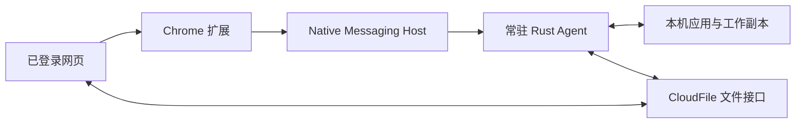

# Chrome 扩展与 Agent 架构及 Windows 兼容契约

日期：2026-10-27。状态：目标设计，按阶段实施；本文不代表双通道、异步受理或新发行机制已经实现。

本设计覆盖共享 Chrome 扩展及 Windows/macOS/Linux Rust Agent。代码复用现有 Core、Native Messaging、私有目录 IPC、任务 Journal 和签名升级器，不增加服务端业务表或第二套提交状态机。

## 1. 现状与需要解决的问题

以 Agent `2c43df5`、扩展 `41e78f1` 的远端 dev 为基线：

- Windows 既有客户端使用 `com.cloudfile.current_agent`，不因跨平台统一而改名。Rust 非 Windows 基线使用历史开发 Host `com.cloudfile.agent22.dev`。
- Native 状态的 `version` 表示协议家族，`build_version` 表示构建版本；`release_channel` 仍写死为 `development`。协议、安装版本和更新通道尚未完整分开。
- 扩展沿用一个固定扩展 ID；已有开发包不能仅凭安装目录不同就认定能与正式版并存。
- IPC 目前可能等待 330 秒，扩展后台和 Native Host 的生命周期不适合作为下载、编辑或上传任务的生命周期。
- 扩展更新仍有业务域名硬编码及 Agent 替换已解压目录的路径，需分阶段转为浏览器支持的发行机制。
- 已有 V2 scoped grant、任务工作副本和持久化 Journal 是保留的业务基础；未发布 Go Agent 不承担兼容义务。

相关功能 PR：Agent [#19](https://github.com/eaopen/cloudfile-local-agent2/pull/19)、扩展 [#6](https://github.com/eaopen/cloudfile-chrome-extension/pull/6)。它们的 Linux/OS 判断修复可复用，但不能据此宣称本文的通道隔离已完成；PR 状态与验收以各自记录为准。

## 2. 职责与通信

| 组件 | 职责 | 权威边界 |
| --- | --- | --- |
| 网页与 Hub | 用户登录、申请绑定用户/库/路径/模式的限时授权、展示结果 | 不指定本机路径、可执行程序、Host 或安装通道 |
| 扩展 | 校验真实 sender、解析受限消息、按用户设置路由、展示能力和状态 | 不持有登录 Cookie、设备私钥或长期文件票据，不执行业务上传 |
| Native Host | 校验消息大小与字段、转交本通道 Agent、返回受理/结果 | stdio 只输出协议帧；诊断写 stderr；不执行任意浏览器命令 |
| 常驻 Agent | 唯一本地任务执行者，管理工作副本、保存观察、上传、独占租约与恢复 | 业务状态持久化，不依赖浏览器或扩展进程常驻 |
| Server | 校验 scoped grant、用户权限、文件条件更新和独占 Guard | 扩展/Agent 的声明不代替服务端授权 |

低频状态查询继续使用短请求，不为保持扩展后台存活而建立永久连接。长任务复用现有私有 IPC 和 Journal，逐步加入可查询的操作状态；只有确有界面实时订阅需要时才使用有界连接。

### 异步受理约定（后续能力）

1. 校验消息格式并持久化受理记录后才回复 `accepted` 和 `operation_id`；未落盘不能宣称已受理。
2. `accepted` 只表示 Agent 已持久化请求，不表示服务端已授权或文件已打开。页面绑定成功会话、开放任务查询应等待授权验证成功。
3. 状态区分 `accepted / running / succeeded / failed / unknown`；超时、断开、处理中和失败分别表达。
4. 同一次用户操作保留稳定的 session/request 标识，优先复用现有幂等依据。重连只查原结果，不重发未知写入或重新消费一次性票据。
5. 操作到具体 Agent 通道的归属在受理时固定。之后切换站点路由不移动或重放既有任务。
6. 扩展只保存查询所需的非秘密标识；票据仅进入 Agent 私有受理记录，消费或过期后按恢复需要清理，不进入浏览器日志或同步存储。

旧 Windows 客户端保持原同步消息和升级行为。只有明确协商到异步受理能力时才启用新约定，不把新回复强加给旧客户端。

## 3. 单扩展、按需双 Agent 通道

同一正式扩展包和固定扩展 ID 可连接两个受控 Host；两个 Host 的 `allowed_origins` 均只列出该扩展的确切 ID。扩展自身代码开发使用独立 Chrome Profile，避免覆盖日常正式扩展。

### 目标身份

| 项目 | stable（正式） | dev（开发） |
| --- | --- | --- |
| Windows Host | 保持 `com.cloudfile.current_agent` | `com.cloudfile.agent2.dev` |
| macOS/Linux Host | `com.cloudfile.agent2` | 同为 `com.cloudfile.agent2.dev` |
| 安装、私有状态、工作副本 | 保持现有路径及位置记录 | 独立开发目录 |
| IPC、实例锁、自启、应用标识 | 保持现有正式身份 | 独立开发身份 |
| 凭据引用与密钥命名空间 | 保持现有正式凭据 | 独立开发凭据，不复制正式凭据 |
| 更新源与签名信任 | 保持正式配置 | 独立开发源与信任配置 |

两个包从同一源码构建，通道由构建/发行配置确定，不能由网页参数覆盖。Host 与桌面二进制的健康检查必须核对通道一致；不只修改目录名或环境变量就宣称完成隔离。

现有历史开发 Host `com.cloudfile.agent22.dev` 不自动改名、不自动接管正式 Host、不自动搬迁现有任务。后续需要迁移时必须提供明确的退出保护、备份与恢复步骤。

### 路由规则

- 默认正式通道。开发人员在扩展高级设置中为确切站点 origin 显式选择开发通道；网页不决定 Host，不使用自动探测顺序决定业务去向。
- 路由键为 Chrome Profile 内的站点 origin，不按最后访问的服务器全局覆盖。新通道的握手须与选定通道一致，否则拒绝业务调用并给出诊断。
- 已有 Windows 客户端缺少新通道字段时，只在原正式 Host 上走受限兼容适配，不扩充其已使用的操作集合。
- OS 信息不可用或未知时，保持 Windows 兼容入口；实际升级包仍由本机升级器校验平台/架构，不凭此默认值安装未经核验的平台包。
- 连接失败、能力不足或响应未知时不跨 Host、跨通道自动重试。开发 Agent 未安装时明确提示，不静默转正式 Agent。
- 客户端通道与服务端环境是两条独立配置：正式 Agent 可连接 DEV 服务，开发 Agent 经明确配置也可连接生产服务；都仍需正常的业务授权。

通道隔离用于避免任务和升级相互覆盖，不能替代服务端权限校验，也不构成对同一 OS 用户下恶意进程的安全隔离。

## 4. 协议、能力和授权

握手采用增量字段，旧 Windows 字段名、类型和已使用语义保持兼容：

| 字段 | 用途 |
| --- | --- |
| `agent_family` | 识别既有客户端适配与 Rust Agent |
| `version` | 保留旧协议家族字段，不改成安装版本 |
| `protocol_version` | 新协议兼容协商，不能用软件发布版本代替 |
| `build_version` | 实际构建展示、更新比较及升级完成复核 |
| `release_channel` | 构建产生的通道元数据；历史 `development` 在适配层归一为 dev |
| `platform`、新增 `arch` | 保持已有 platform 字符串类型，补充架构信息 |
| `capabilities` | 实际可执行操作，保留已有名称，新能力增量加入 |

新协议按协议版本和能力判断，不用 `^2.x.x` 的软件版本正则代替能力协商。旧 Windows 客户端通过明确的兼容适配保留原本地操作与更新入口；缺少字段不是自动获得新能力的依据。V2 授权不能降级发给不支持它的旧客户端。

每次外部请求都验证真实 sender origin、消息字段和大小，并绑定允许的服务、用户身份及具体资源。通用部署可以支持客户域名/IP，但未知站点不能因此取得本地任务、路径或文件信息。企业部署由受控配置限定站点；避免在通用产物里硬编码客户业务域名。

Agent 的服务信任与 Server 对 scoped grant 的最终校验共同生效。只读查看、普通编辑和独占编辑仍由现有 Core/Server 状态机约束。浏览器只获得所需最小结果，不获得任意文件路径、设备秘密或提交凭证。

任务查询与操作须绑定对应服务和用户的有效授权上下文；注销或换用户后，旧 origin 绑定本身不能继续授权访问之前用户的任务。复用当前授权事实，不新增第二套身份数据库。

## 5. 分别发行和升级

### Chrome 扩展

目标正式发行使用 Chrome Web Store 或企业策略管理的自托管扩展；企业内网优先评估后者。已解压扩展仅用于开发验证，不作为长期正式更新机制。

现有 Windows 用户仍使用原可用安装/更新入口，直到替代部署方式真实验收。后续迁移不能直接删除旧入口或要求全部用户重新安装；扩展 ID、允许的权限和业务调用保持兼容。

扩展权限按实际使用最小化；删除权限必须先验证真实调用。浏览器扩展版本与 Agent 版本分别发布，二者通过能力协商兼容，不要求同步升级。

### Rust Agent

复用现有分版本目录、签名清单、SHA-256、平台和 IPC/Journal 校验、健康检查、切换与回退。增加通道校验与开发/正式签名隔离，安装/更新/卸载只管理本通道。

旧 Windows 正在使用的清单结构和签名覆盖范围保持兼容；需要新字段时引入版本化清单入口及明确适配，不能把新字段直接塞进拒绝未知字段的旧解析器。沿用已固定的信任锚，不从待验证的更新源自行取得可信公钥。

健康检查校验 native host 与桌面组件、目标平台/架构、通道及数据格式兼容性。有未确认提交、进行中上传或活动独占租约时，升级保持暂存，安全后再切换；失败保留旧版本、工作副本及 Journal。更新检查不可触发任务迁移或业务提交。

Linux 尚无正式更新通道和登录自启验收时，明确标注开发支持范围，不虚构一键升级成功。

## 6. Windows 必须保持的兼容边界

- 正式 Host、扩展 ID、HKCU 注册位置、普通用户安装方式及安装器编码保持原契约。
- 现有数据目录、工作副本位置、Journal、设备凭据和用户自定义打开规则保持可读可恢复；开发版不能接管或清理它们。
- 保留旧 Windows 客户端既有查询、打开、升级和错误语义。新元数据缺失时走原适配，不能因 macOS/Linux 支持而屏蔽旧功能。
- 系统识别失败默认 Windows；正式 Host 缺失不尝试废弃 Go Host或开发 Host。
- 稳定升级的签名、平台、健康检查、回退和未完成任务保护不降低；开发包不得自动替换正式注册。
- 不改变 Windows WebView2 探测、系统文档关联、Office/CAD 打开和保存处理，不绕过系统软件执行策略。

## 7. 实施顺序与验收

| 阶段 | 范围 | 退出条件 |
| --- | --- | --- |
| A：契约与兼容 | 文档统一；增量握手和能力适配；明确构建通道 | 旧 Windows 状态、打开及升级回归通过；缺失字段仍可使用原能力 |
| B：按需并存 | 开发身份/数据/更新隔离；扩展按站点显式路由 | 两个 Agent 同时安装运行；互不接管 Host、锁、工作副本、凭据或更新状态 |
| C：可靠受理 | 新能力下的持久化受理及原操作查询 | 扩展后台终止、浏览器退出、Native Host 重启、超时后任务可恢复且无重复写入 |
| D：正式发行 | 企业/商店扩展分发及各平台签名升级 | Chrome 真实安装更新；Agent 更新/回退/卸载通过且业务文件不丢失 |

每个阶段独立 PR，不为了先落地其他平台而修改 Windows 正式入口。Windows 验收覆盖既有客户端与 Rust、新旧元数据混用、未知 OS、WebView2 缺失、Office 保存、活动任务升级保护及回退。跨通道验收须包含错误包/通道拒绝、只卸载一方及切换路由后已有任务归属不变。

macOS/Linux 分别验证用户级 Host 注册、系统凭据、真实应用打开、查看不回传、编辑保存回传以及权限拒绝。编译、Mock、CI 和真实服务端验收分别记录，不互相替代。

## 8. 官方依据

以下资料用于支撑生命周期、来源校验和发行方式；通道命名及兼容策略是本项目设计决策，并非 Chrome 的强制要求。

- [Native Messaging](https://developer.chrome.com/docs/extensions/develop/concepts/native-messaging)：Host 注册、allowed_origins、stdio 帧与消息进程生命周期。
- [扩展后台生命周期](https://developer.chrome.com/docs/extensions/develop/concepts/service-workers/lifecycle)：后台可能终止，任务状态需可恢复。
- [消息来源与校验](https://developer.chrome.com/docs/extensions/develop/concepts/messaging)：校验来源、限制可触发的操作与响应数据。
- [正式扩展发行](https://developer.chrome.com/docs/extensions/how-to/distribute)：商店、企业策略及开发期已解压扩展的边界。
